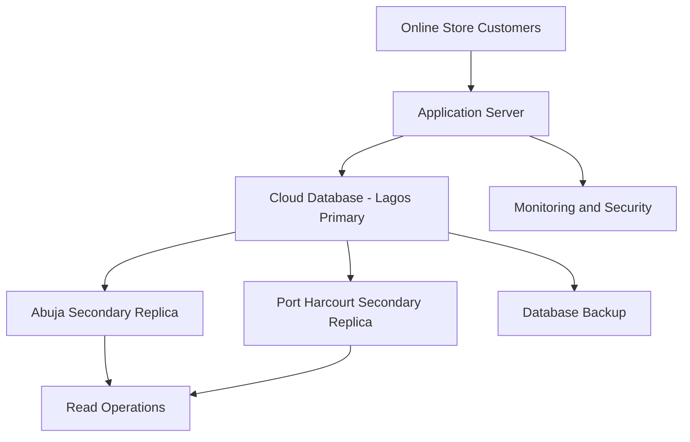

# Distributed Database Architecture Diagram

## Laykes Online Store

The proposed architecture uses a primary database in Lagos and secondary replicas in Abuja and Port Harcourt.

## Architecture Explanation

1. Customers access Laykes Online Store through the application server.
2. The application server communicates with the primary database in Lagos.
3. Database changes are replicated to secondary servers in Abuja and Port Harcourt.
4. Secondary replicas can support read operations.
5. Backups protect important business information.
6. Monitoring and security controls help protect the database infrastructure.

## Conclusion

The proposed architecture provides a foundation for improved scalability, availability and database recovery.
